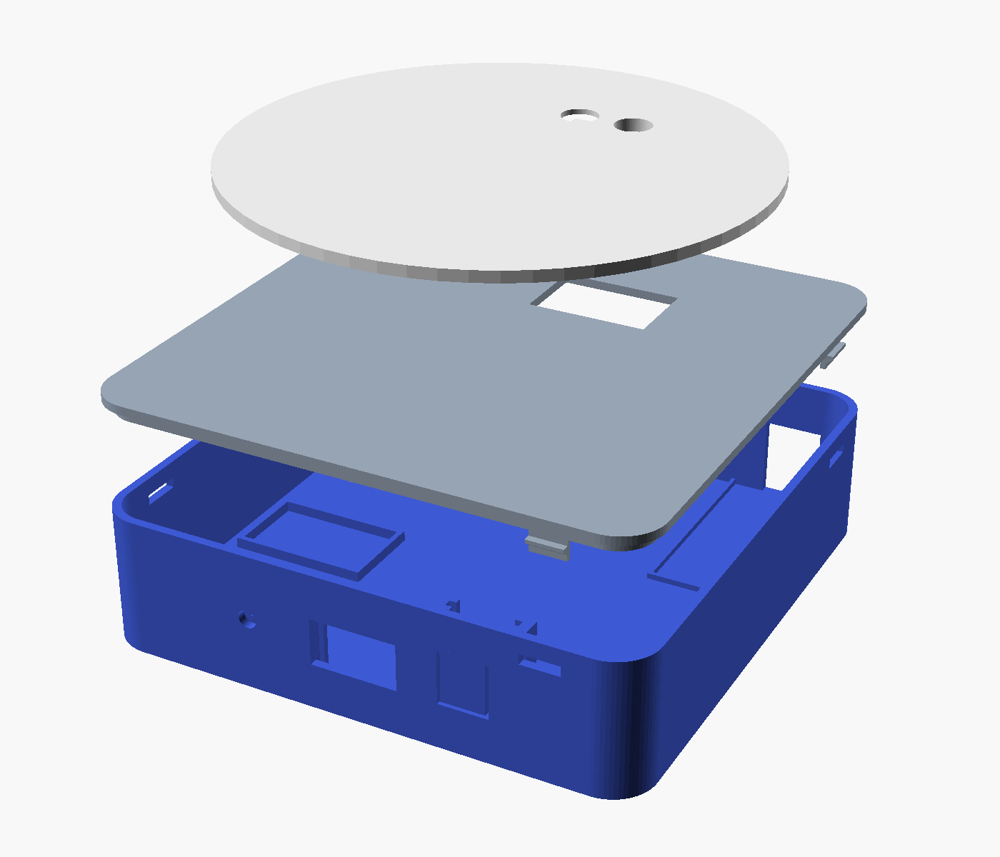

# Gehäuse für die PrintDock Station

Drei Teile zum Drucken, gebaut für D1 Mini (ESP8266/ESP32) und ESP32-DevKit.



| Datei | Teil | Druckrichtung |
|---|---|---|
| `base.stl` | Unterteil 150 × 150 × 38 mm, Halterungen für Board, HX711, OLED, Taster, LED | Boden unten |
| `deck.stl` | Deckel mit Schienen für den PN532, wird eingeklickt | Oberseite nach unten |
| `plate.stl` | Teller Ø 140 mm mit Pfosten auf der Wägezelle | Tellerfläche nach unten |

PLA oder PETG, 0,2 mm, 3 Wände, 15–20 % Füllung, **ohne Stützen**.

## Zusammenbau

Nur die Wägezelle wird geschraubt (4 Schrauben, je nach Zelle M4 oder M5 – die Löcher passen für beide). Alles andere wird gesteckt oder geklickt.

1. **Wägezelle:** mit 2 Schrauben (M4/M5 × 12) von unten an den Sockel – das ist das feste Ende. Der Pfeil auf der Zelle zeigt nach unten. Die Mitte der Zelle muss frei schweben.
2. **HX711** in die Mulde vorne links legen, **Board** (D1 Mini, D1 Mini ESP32 oder ESP32-DevKit) mit Doppelklebeband in die Bucht hinten rechts, USB zur Öffnung in der Rückwand.
3. **OLED**, **Taster-Modul** (KY-004, Knopf nach vorn) und **LED** (runde WS2812-Platine) von oben in ihre Schlitze an der Front schieben. Gedrückt wird der Taster über die federnde Zunge in der Front.
4. **PN532** (bei ESP32 SPI, beim D1 Mini ESP8266 I²C einstellen) von der Seite in die Schienen unter dem Deckel schieben, Bauteile nach unten, Steckerleiste zum offenen Ende. Kabel anstecken, Deckel einklicken.
5. **Teller** aufsetzen und mit 2 Schrauben (M4/M5 × 30) von oben durch den Pfosten an das freie Ende der Zelle schrauben.
6. Optional 4 Gummifüße (Ø 10 mm) in die Mulden unten kleben.

Danach in PrintDock *Tara* und *Kalibrieren*.

## Anpassen

`printdock-station-case.scad` ist ein OpenSCAD-Modell mit Parametern oben in der Datei: Maße von PN532, OLED, Taster, Wägezelle (Lochabstand, Lage), Spiel der Steckverbindungen (`gap`), Tellergröße. Neue STL erzeugen:

```sh
openscad -D 'part="base"'  -o base.stl  printdock-station-case.scad
openscad -D 'part="deck"'  -o deck.stl  printdock-station-case.scad
openscad -D 'part="plate"' -o plate.stl printdock-station-case.scad
```

Zugrunde gelegte Maße: PN532 V3 42,7 × 40,4 mm, OLED 0,96″ 27,3 × 27,8 mm, KY-004 18,5 × 15 mm mit 6-mm-Taster, WS2812-Platine Ø 10 mm, HX711 34 × 20 mm, Wägezelle 80 × 12,7 × 12,7 mm mit Lochabstand 15 mm und erstem Loch 5 mm vom Ende. Weichen deine Teile ab, die Werte oben in der Datei ändern.
