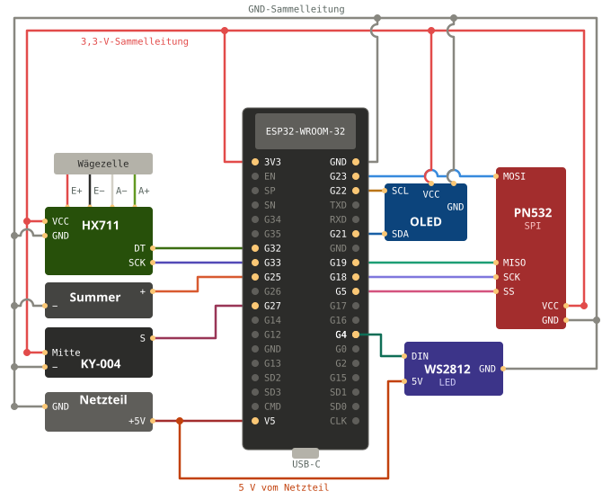
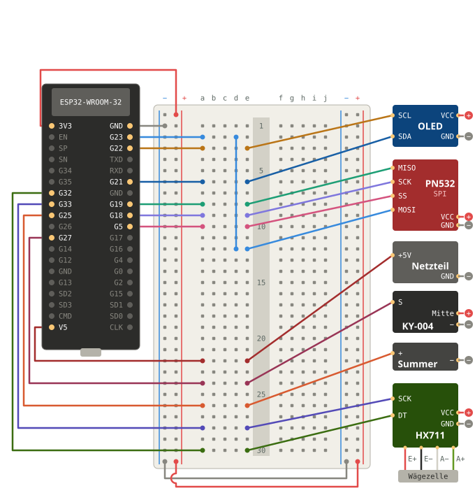
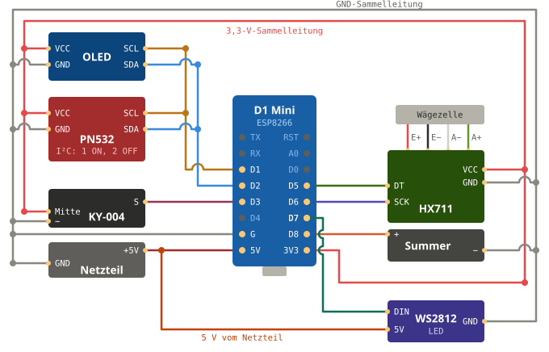
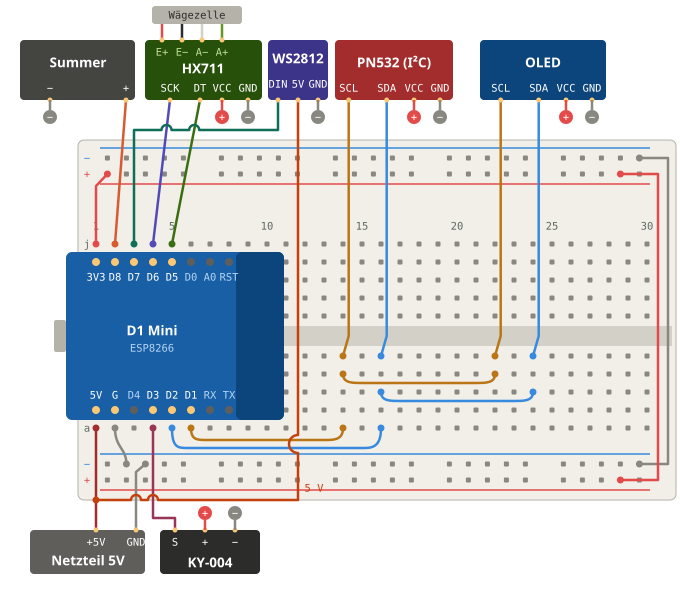

# Verdrahtung und Stückliste

Gleiche GPIOs für **ESP32-WROOM-32 DevKit** (30/38 Pin) und **D1 Mini ESP32** (Wemos/LOLIN, 2 × 20 Pins). Der klassische **D1 Mini mit ESP8266** geht auch – mit eigener Belegung und dem PN532 im I²C-Modus, siehe [unten](#d1-mini-esp8266). Alle Module laufen mit 3,3 V, nur die WS2812-LED braucht 5 V.

## Stückliste

| Teil | Hinweis | ca. Preis |
|---|---|---|
| ESP32-WROOM DevKit **oder** D1 Mini ESP32 | jeder ESP32 mit 4 MB Flash | 4–8 € |
| *oder* D1 Mini ESP8266 | der „normale“ Wemos D1 Mini (4 MB Flash) | 3–5 € |
| PN532-NFC-Modul (rot, „V3“) | liest/schreibt NTAG213/215/216, liest MIFARE Classic | 4–8 € |
| HX711 + Wägezelle 5 kg | Balken-Wägezelle (Aluminium) | 4–7 € |
| OLED 0,96″ 128 × 64, SSD1306, I²C | 4 Pins (GND, VCC, SCL, SDA) | 3–5 € |
| WS2812B-LED (einzeln oder Mini-Ring) | optional – zeigt die Spulenfarbe | 1–3 € |
| Taster | optional – kurz: erneut melden, lang: Tara | <1 € |
| Passiver Summer | optional | <1 € |
| Feuchtesensor SHT31, SHT40, AHT20 oder HTU21D (I²C-Modul) | optional – misst Feuchte und Temperatur, z. B. in der Trockenbox | 2–6 € |
| NTAG215-Sticker (25 mm) | für eigene Spulen; NTAG213 reicht für „Nur Link“ / „Anycubic ACE“ | 0,20–0,40 €/Stk |

## Anschlüsse

| Modul | Pin am Modul | ESP32-GPIO |
|---|---|---|
| **PN532** (SPI) | SCK | 18 |
| | MISO | 19 |
| | MOSI | 23 |
| | SS / NSS | 5 |
| | VCC / GND | 3V3 / GND |
| **HX711** | DT / DOUT | 32 |
| | SCK | 33 |
| | VCC / GND | 3V3 / GND |
| **OLED** | SDA | 21 |
| | SCL | 22 |
| | VCC / GND | 3V3 / GND |
| **WS2812** | DIN | 4 |
| | 5V / GND | 5V (VIN) / GND |
| **Taster** | – | 27 ↔ GND |
| **Summer** | + | 25 (− an GND) |
| **Feuchtesensor** | SDA / SCL | 21 / 22 (parallel zum OLED) |
| | VCC / GND | 3V3 / GND |

### Plan ESP32

Schaltplan (direkt verdrahtet) und Aufbau auf dem Steckbrett, beschriftet für das ESP32-DevKit mit 38 Pins. Alle vier Pläne mit Lochtabellen auf einer Seite: [wiring.html](wiring.html) (herunterladen und im Browser öffnen).

Das Steckbrett ist um 90° gedreht: Spalte 1 oben, Reihen a–j von links nach rechts. Das ESP-Kabel steckt in a, das Modul-Kabel in e derselben Spalte (jede Spalte verbindet nur a–e). Kabel vom ESP32 zum Brett: Buchse–Stecker.

### PN532 auf SPI stellen

Auf dem roten PN532-Modul (Elechouse V3 und Nachbauten) sitzen zwei kleine Schalter:

| Modus | Schalter 1 | Schalter 2 |
|---|---|---|
| **SPI** (verwendet) | OFF | ON |
| I²C | ON | OFF |
| HSU (UART) | OFF | OFF |

Findet die Station den Leser nicht, zeigt das Display „NFC-Leser nicht gefunden – SPI-Modus prüfen“.

### D1 Mini ESP8266

Der ESP8266 hat zu wenige freie Pins für SPI, darum hängen PN532, OLED und Feuchtesensor gemeinsam am I²C-Bus. **PN532 auf I²C stellen** (Schalter 1 ON, Schalter 2 OFF).

| Modul | Pin am Modul | D1 Mini |
|---|---|---|
| **PN532** (I²C) | SDA | D2 |
| | SCL | D1 |
| | VCC / GND | 3V3 / GND |
| **OLED** | SDA / SCL | D2 / D1 |
| | VCC / GND | 3V3 / GND |
| **Feuchtesensor** | SDA / SCL | D2 / D1 |
| **HX711** | DT / DOUT | D5 |
| | SCK | D6 |
| | VCC / GND | 3V3 / GND |
| **WS2812** | DIN | D7 |
| | 5V / GND | 5V / GND |
| **Taster** | – | D3 ↔ GND |
| **Summer** | + | D8 (− an GND) |

PN532 und OLED teilen sich SDA und SCL – die Abzweige als Lötstelle oder mit einer kleinen Klemme verbinden. Netzteil und USB nicht gleichzeitig anstecken.

**Taster an D3:** D3 ist zugleich der Flash-Pin. Beim Einstecken darf er nicht gedrückt sein, sonst startet der D1 Mini im Flash-Modus. Zum Zurücksetzen darum erst einschalten und dann, wenn „Zurücksetzen: jetzt Taste halten“ erscheint, die Taste 5 s halten.

Firmware: `printdock-station-d1_mini-<version>.factory.bin` (ab 0.3.0).

### Flashen klappt nicht?

- **„Chip is ESP8266“** beim Flashen eines ESP32-Images: falsches Board – für den D1 Mini ESP8266 die Datei `…d1_mini-….factory.bin` nehmen.
- **„Flash ID: 0“ / „Failed to communicate with the flash chip“**: Der Flash-Speicher antwortet nicht. Dann wird nichts geschrieben, auch wenn der Fortschritt bis 100 % läuft. Meist liegt es am USB-Kabel (nur Ladekabel), zu wenig Strom (USB-Hub) oder an angeschlossenen Modulen – alles abstecken, direkt am Rechner mit einem anderen Kabel probieren. Bleibt es bei 0, ist das Board defekt.
- Treiber für den USB-Chip: CH340 (Vendor 0x1A86) bzw. CP2102.

### NFC-Leser reagiert nicht?

- **Kein Piep, kein „Tag erkannt“ beim Auflegen:** Der Leser sieht den Tag nicht. Karte direkt flach auf das Modul legen (Reichweite nur 2–4 cm).
- **Beim Einschalten „NFC-Leser nicht gefunden“** bzw. in PrintDock *ohne NFC-Leser*: Schalter am PN532 prüfen (ESP32: SPI = 1 OFF, 2 ON; D1 Mini ESP8266: I²C = 1 ON, 2 OFF), danach die Station **ganz stromlos** machen – der PN532 liest die Schalter nur beim Einschalten. Verdrahtung prüfen, besonders MISO/MOSI nicht vertauschen.
- **ESP32-DevKit mit 38 Pins:** MOSI gehört an **G23** (rechts, zweiter Pin von oben, direkt unter GND). Der Aufdruck sieht dort leicht wie „G33“ aus – G33 ist aber links und gehört zur Waage.
- **Geht nur ab und zu:** fast immer ein Wackelkontakt an den Dupont-Steckern oder zu lange Kabel (über 15–20 cm). Ab Firmware 0.3.1 prüft die Station alle 3 Sekunden, ob der Leser antwortet, richtet ihn bei einem Hänger selbst neu ein und zeigt „NFC-Leser antwortet nicht – Kabel prüfen“, wenn er ganz weg ist. Im Gehäuse am besten löten.
- **D1 Mini ESP8266: Display und NFC bleiben beide dunkel:** PN532 und Display teilen sich den I²C-Bus – ein falsch eingestellter oder hängender PN532 legt den ganzen Bus lahm. Zum Test den PN532 abziehen: Läuft dann das Display, Schalter (I²C) und SDA/SCL am PN532 prüfen (SDA an D2, SCL an D1, nicht vertauscht).

### Wägezelle an den HX711

| Ader | HX711 |
|---|---|
| rot | E+ |
| schwarz | E− |
| weiß | A− |
| grün | A+ |

Zeigt die Waage negative Werte, A+ und A− tauschen. Die Wägezelle braucht eine feste Unterlage auf der einen Seite und den Teller auf der anderen. Eine Spule (Ø 200 mm) liegt auf einem Teller von etwa 120–150 mm sicher auf.

### Nur als Feuchtemesser (PrintDock Sensor)

Ohne PN532 und HX711 – nur ESP32 bzw. D1 Mini, Feuchtesensor und optional das OLED – wird die Station zum **PrintDock Sensor**, einem Funk-Feuchtemesser, etwa für eine Trockenbox ohne eigene Anzeige oder ein AMS/ACE ohne Messung. In PrintDock erscheint er unter *Einstellungen → Drucker & Filament → Feuchte & Trocknen* zum Koppeln und wird dort einer Messstelle zugeordnet. Der Sensor sollte in der Box sitzen; das ESP32 kann außen bleiben (vier Adern, bis etwa 1 m).

## Erster Start

1. Firmware flashen:
   - Im Browser über https://web.esphome.io → *Connect* → `printdock-station-<board>-<version>.factory.bin`.
   - Oder mit esptool: `esptool.py write_flash 0x0 printdock-station-esp32dev-0.1.0.factory.bin`.
2. WLAN einrichten: mit dem WLAN **PrintDock-Station** verbinden, **http://192.168.4.1** öffnen, *Configure WiFi* → Heim-WLAN, Passwort und PrintDock-Adresse → *Save*. Ausführlich: [WLAN einrichten](#wlan-einrichten-schritt-für-schritt).
3. Das Display zeigt einen sechsstelligen Code. In PrintDock unter *Einstellungen → PrintDock Station* denselben Code bestätigen.
4. Waage kalibrieren: leer *Tara*, dann ein bekanntes Gewicht auflegen und *Kalibrieren*.

**Zurücksetzen:** Taster beim Einschalten 5 Sekunden halten (D1 Mini ESP8266: erst einschalten, dann halten, sobald „Zurücksetzen: jetzt Taste halten“ erscheint). Das löscht WLAN, Adresse und Kopplung – danach öffnet die Station wieder das WLAN „PrintDock-Station“.

### WLAN einrichten (Schritt für Schritt)

Beim ersten Start – oder wenn die Station ihr Heim-WLAN nicht findet – öffnet sie ein eigenes WLAN. Das Display zeigt dann *Einrichten · WLAN verbinden: PrintDock-Station · 192.168.4.1*.

1. Mit Handy oder Laptop das WLAN **PrintDock-Station** wählen (offen, kein Passwort).
2. Meist öffnet sich die Einrichtungsseite von selbst („Im Netzwerk anmelden“). Falls nicht: im Browser **http://192.168.4.1** aufrufen. Am Handy dafür mobile Daten kurz ausschalten, sonst sucht der Browser im Internet.
3. Auf der Seite **„Configure WiFi“** tippen.
4. Heim-WLAN aus der Liste wählen (nur 2,4 GHz – 5-GHz-Netze sieht die Station nicht) und das **WLAN-Passwort** eintragen.
5. Darunter ins Feld **„PrintDock-Adresse“** die Adresse von PrintDock eintragen, z. B. `192.168.1.20:3080`. Beim Home-Assistant-Add-on ist das die IP von Home Assistant mit Port 3080. Die passende Adresse zum Kopieren steht in PrintDock unter *Einstellungen → PrintDock Station → Station einrichten*.
6. **„Save“** tippen. Die Station verbindet sich mit dem Heim-WLAN, das Einrichtungs-WLAN verschwindet, und das Display zeigt „Verbinde …“ und danach den Kopplungscode.

Klappt es nicht:
- **Das WLAN „PrintDock-Station“ taucht wieder auf:** WLAN-Passwort falsch oder 5-GHz-Netz gewählt – Schritte wiederholen.
- **Display zeigt „PrintDock nicht erreichbar“:** Adresse oder Port falsch. Station zurücksetzen (siehe unten) und die Adresse neu eintragen.
- Die Einrichtungsseite schließt sich nach 5 Minuten ohne Eingabe; die Station startet dann neu und öffnet das WLAN wieder.

